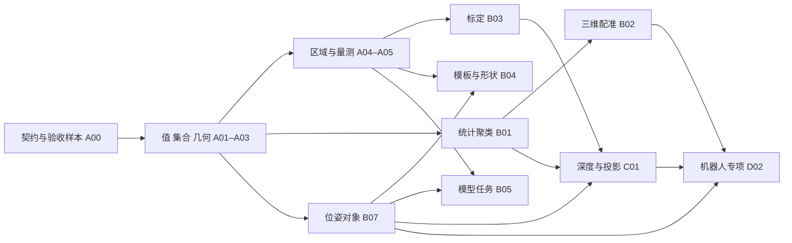

# 算子补齐计划

[文档中心](README.md) · [198 项能力对照](operator-coverage.md) · [当前范围](roadmap.md)

状态：**P0/P1限定切片、P2 A01受限表达式及A05高光限定用途已实现；六阶段交付当前阶段1进行中，其余按原优先级继续**。初始基线为 `32a3700e435c753df46916e1dc029a9d59b8d95e`；实现版本 1.3.7，日期 2026-11-14。P0 按 23 项外部源码逐个核实、优化后实现，详见[分析与剩余边界](p0-operator-analysis.md)及 [ADR-0029](adr/0029-p0-values-geometry-and-image-contracts.md)。P1新增55个算子，逐条分析与可用链见[P1实现索引](p1-operator-analysis.md)。外部名称用于追踪需求，不作为 LyFlow 新 ID 或接口设计。

## 决策摘要

初始 198 项对照为已有 11、可组合 7、部分覆盖 49、缺失 126、待核实 5。P0后已有28、可组合7、部分45、缺失113、待核实5；P1后更新为已有 **54**、可组合 **7**、部分覆盖 **45**、缺失 **87**、待核实 **5**。P2 A01后为已有55、可组合7、部分45、缺失86、待核实5；A05高光限定用途实现后为已有 **56**、可组合 **7**、部分 **45**、缺失 **85**、待核实 **5**。47个P1条目中26项已有对应限定用途、21项继续部分覆盖；这不是完整协议或全部模式兼容率。云分组、工件集合及真正三维配准已有明确实现，仍缺的原生几何集合、业务协议、检测分割与高级模式单独保留。逐项限制和源码证据见[对照表](operator-coverage.md)。

优先顺序是：**数据契约 → 通用值/集合/几何 → 图像区域与量测 → 点云统计/聚类与三维配准 → 标定/定位/模型任务 → 深度及机器人专项**。通用值和集合可同时支撑传统视觉、模型后处理与业务判定，先做这些可减少后续节点中的重复逻辑。

本计划按能力组织任务，不要求外部每个类都在 LyFlow 中新增一个节点。纯结果查看使用编辑器；发布、采集、文件归档和服务上传优先放宿主；算法放算子包；成熟组合以片段/子图交付。Python SDK 是实现途径，不是算法已经存在的证据。

## 优先级与规模口径

默认面向通用工业图像、点云及 glue/gap 工作流；机器人拣选、箱体拆垛和指定硬件没有默认业务优先权。有真实项目、样本和判据后可调整顺序。

| 初始优先级 | 排序依据 | 初始清单条目数 |
|---|---|---:|
| P0 | 基础链缺口，复用面广，且阻塞后续能力 | 23 |
| P1 | 通用视觉的主要完整链，可明确验证收益 | 47 |
| P2 | 依赖前两阶段，或需要模型、标定、专项数据 | 55 |
| P3 | 机器人/硬件/宿主专项，需要外部系统和业务验收 | 50 |
| 待定义 | 外部描述不足，先确认契约再定实现优先级 | 5 |
| 无需补齐 | 当前限定用途已有或可组合；不含原协议兼容 | 18 |

这些是补齐前各条目的**主要优先级**，合计 198，不是当前剩余任务数或 198 个开发任务。P0 的 23 行保留原分组以便追踪，交付后各行仍列出未覆盖模式。下面每个任务族可有多个阶段切片；完成基础切片不能把依赖它的全部外部条目都标成完成。复杂度用 S/M/L 表示相对规模：S 为局部可验证改动，M 为跨算法/端口/界面的能力链，L 涉及数据模型、ABI、模型资产或业务标定。未有契约和数据前不承诺人日或日期。

## 依赖和实施批次

| 批次 | 最小可交付范围 | 出口条件 |
|---|---|---|
| 第一批：P0 通用链 | A00；A01 基本四则/比较/布尔；A02 有界值列表；A03 点线圆/平面构造及基础几何；A04 图像运算、区域/掩膜、灰度统计；A05 基础直线卡尺与宽度范围 | 一张“读取 → ROI/阈值 → 连通域或卡尺 → 统计/比较 → 条件输出”示例可在桌面、CLI、嵌入宿主得到相同结果，并有明确无目标/多目标/错误语义。 |
| 第二批：P1 主要视觉链 | A02 云集合；A03 几何变换；A04 颜色/实例扩展；A05 圆弧/环宽与单线扫切片；B01、B02 基础切片；B03 相机/平面/标定板；B04 NCC；B05 固定模型检测；B06 点云格式；B07 基础位姿、集合与文本往返 | 限定切片已实现：标定量测、三维簇统计/配准、YOLOX-Nano与YOLOv8n/YOLO11n/YOLO26n检测链及可复用示例。当前门禁以对应源码修订的完整CI/集成报告为准；不把未覆盖模式或一次运行算作验收。 |
| 第三批：P2 扩展链 | A01 受限表达式；A05 高光；B01 相对高度/规则；B02 全局匹配；B03 Marker/工作空间文件；B04 形状匹配；B05 语义分割/标注/OCR/识码；B06 合成盒云；B07 高阶姿态、对象裁云、日志/外部发布；C01–C03；D01 通用会话/回放/结果适配 | 每项有独立数据集、质量指标和依赖清单；不以“有 ONNX/有 Python”省略后处理、数据契约或部署验证。 |
| 专项：P3 | B04 工作空间重定位；C03 外部可视化；D01 设备/业务上传；D02 机器人专项，由业务输入触发 | 明确设备、坐标系、协议、样本及现场责任方，独立验收。通用契约设计可先做，专项实现不挤占前两批。 |

各批次内部按下列依赖拆成独立 PR；一个 PR 聚焦一份契约及其可验证行为。先实现不改变 ABI 的部分；需要新核心类型时先完成 A00 决策与兼容门禁，再写依赖它的节点。

P2 A01已由[PR #53](https://github.com/liangyuR/lyFlow/pull/53)合并；用户继续授权余下六阶段依次实施、分别PR，前一阶段功能证据、CI与Codex审查通过并合并后才开始下一阶段。范围、54项映射与当前状态见[六阶段交付跟踪](p2-sequential-delivery.md)。

## P1 当前实施状态

本轮新增节点数与初始条目数不同：点云/剖面18、工件/几何19、图像14、检测前后处理4，共55个。BestFit与SearchPoseLocally的基础子能力随B02先实现，原清单P2优先级不改，完整高阶规则仍未交付。其余阶段的初始数量和优先级不变。

| 任务族 | 已实现的P1切片 | 明确保留的边界 |
|---|---|---|
| A02 | 原生云+Indices+cloud.Groups.v1的包装、取组、子集、拼接、合并与统计；工件concat/get | 通用原生GeometryVector及旧动态集合协议 |
| A03 | 二维点线圆相似变换、平面逆转置/补偿偏移 | 任意三维几何集合及全局FrameTree |
| A04 | 两图拼接、显式颜色/平场校正、Pose2D标签mask及实例形态学 | 任意资产mask、3D工件投影、Auto均衡及方向性形态背景模式 |
| A05 | 圆/圆弧亚像素卡尺、径向环带宽度、单剖面直线及双区间gap/flush | 固定半径、过圆心直径、全部信号组合及业务缝型 |
| B01 | 全云统计/PCA/AABB/PCA盒、XYZ欧式簇、规范组ID和顺序多平面 | 平面箱面最小矩形、法线/organized聚类及workspace/相对高度规则 |
| B02 | 对应点刚体拟合、点点/点面局部SE(3) ICP、至多9初值搜索，实际float32输出质量门控 | 全局匹配、混合加权3-2-1、全部轴组合网格及外部工件批处理 |
| B03 | K/D读取、去畸变、平面H重采样/距离、棋盘PnP和显式双轮廓外参投影 | Marker/Charuco、手眼/设备YAML/工作空间格式、全局帧树及自动中心推断 |
| B04 | 原生模板及掩膜NCC、离散旋转/尺度、多实例和旋转框NMS | 亚像素、轮廓形状、多视角三维与工作空间重定位 |
| B05 | YOLOX-Nano 0.1.1rc0、YOLOv8n、YOLO11n、YOLO26n各自明确的float32检测链 | 实例分割、可抓区域、OBB、多ROI批处理及任意导出格式 |
| B06 | PCD/点顶点PLY/STL面积采样、字段/资源预检、m/mm和初始刚体 | Mesh拓扑、目录查找策略、额外未知通道及盒体合成云 |
| B07 | Pose2D/3D、集合/基础筛选、属性更新、帧变换/偏移、2D轴规范、定位点坐标系、已知平面映射、2D比较及JSON往返 | 3D对称/碰撞规则、变换笛卡尔展开、对象裁云/任意深度、跨帧关联及发布/专用查看器 |

逐项源码取舍见[点云](p1-analysis-cloud.md)、[工件](p1-analysis-pose.md)、[图像](p1-analysis-image.md)和[模型](p1-analysis-detection.md)。软件真值、真实模型与执行入口的永久验证入口见[P1索引](p1-operator-analysis.md#示例与验证入口)；不把公开模型图或合成点云当作现场生产验收。

## 任务定义

P0 实现已分别归入 [std-value](../packs/std-value/README.md)、[std-geometry](../packs/std-geometry/README.md)和 [std-image](../packs/std-image/README.md)。现有 C ABI 保持不变；基础数值/文本通过顶层图参数按次覆盖，小型结果使用受校验的版本化 Record。P1已实现cloud.Groups.v1、vision.Pose2D/3D.v1及其集合同帧/单位校验，继续使用现有原生数组与受校验Record，不新增Data种类或C ABI。以下任务定义保留验收要求，当前已完成切片以上表为准。

### A00 · 数据契约、样本与类型扩展门禁（P0，L）

**前置任务**：无。第一批必须先完成此项的决策与验收样本定义，不能边堆算法边让端口含义漂移。

- 明确数值/布尔/字符串、值列表、工件实例、坐标帧、相机标定和动态云集合的表示方式。数字不滥用 `Measurement.ok`；工件不是 Transform 的别名；二维几何区分 pixel/meter，测量值保留单位。
- 小型结构可考虑版本化 `Record.type` 和受校验的 JSON schema，但必须交付生产者、消费者及运行时校验，不能只用裸 Record/Any 宣称类型支持。固定字段 `Bundle<kind>` 不代替动态列表。图像、点云、网格及大数组不得塞入 Record JSON、进程指针或 base64。
- 动态云集合需定义元素身份、顺序、可选通道、索引来源和内存所有权；评估多云对象与“单云 + 分组索引”的取舍。现有 Indices 的 `sourceCloudId` 不能丢失。若需新增核心类型，先出 ADR，再按[发包与 ABI 规则](deployment/packaging.md)同步 C ABI、C++/Rust、结果仓、Transport、持久化与查看器。
- 明确 frame ID、变换方向、欧拉角顺序、角度单位、右手系、深度单位、图像颜色顺序、时间戳来源和标定版本。相机内参、平面单应性、手眼外参、工作空间标定分别定义。
- 定义空结果、无目标、NaN/Inf、退化几何、尺寸不匹配、版本不兼容和取消的诊断；没有检测目标可以是有效空集合，错误不伪装为空成功。

**验收**：契约样本覆盖上述正反例，旧原生工作流不变；任何新核心类型完成跨边界往返和兼容检查。选定真实/合成测试集及可追踪预期结果，许可和来源可交付。

### A01 · 值、算术、比较和布尔运算（P0 起，M）

**依赖**：A00 的值和单位契约。对应 InputNumber/InputInfo、BasicArithmetic、CompareNumbers、LogicOperation，以及后续 GeneralArithmetic。

第一切片提供可连接常量/信息源、四则运算、比较及布尔组合，与现有 `flow.select` 对接；区分数字与带单位测量，不隐式跨单位比较。多输入广播、空值传播、除零、阈值等号边界都要定义。后续表达式仅提供受限文法、函数白名单和运行限制，不用任意 `eval`。

**验收**：常量和宿主信息两条输入路径一致；容差比较、混合单位、除零、非法表达式、短路或惰性语义有明确结果；可接现有条件分支，不破坏惰性执行。

**P2首项实施状态**：`value.expression` 已提供a..h固定可选值口、受限语法、9个白名单函数、严格number/boolean与单位校验、完整语法验证、AST内部短路及资源/取消限制。外部GeneralArithmetic核心公式用途标为限定覆盖；动态端口/任意变量名和原协议不兼容，图上游继续正常调度。详见[源码分析与契约](p2-expression-analysis.md)。本次不标记其余54个P2条目已完成。

### A02 · 集合与索引（P0 值列表；P1 云集合，L）

**依赖**：A00；值列表依赖 A01。对应 FetchElement、MergeVector、ConcateVector、VectorSubset、CloudVectorToCloud，工件集合规则与 B07 共享。

先实现小型值/记录列表的构造、取项、拼接、子集、稳定排序和显式索引；外部“Merge”与“Concate”的去重、扁平化语义先核实，不能按名称合并。再交付多云集合访问和合并，保留每片云身份及通道规则。`util.merge` 拼两云继续复用，不把动态集合展开为无限端口。

**验收**：空/单项/多项、越界、重复索引、负索引策略、稳定排序、元素类型不符和通道缺失均有确定结果；数组往返不丢实例身份，索引不能误用于另一片云。

### A03 · 几何构造与通用二维计算（P0 起，M）

**依赖**：A00、A01。对应 GenerateGeometry2D/InputPlane、CalculateGeometryDistance、Geometry2DIntersection、GeometryTransformation。

复用现有 Point2D/Line2D/Circle2D/Plane，增加构造、变换、点线圆距离、中点和求交。先明确直线/线段、定向/无向距离、多交点输出和容差，不能直接把 gap 的带工况约束求交当作通用版本。平面法向归一化、偏移符号和参考系单独验证。

**验收**：平行、重合、相切、无交点、双交点、零长线段、非法半径和不同单位均有契约；变换后的几何与原测量值可校验。

### A04 · 图像基础运算、区域和统计（P0 起，M）

**依赖**：A00–A02。对应 BlobDetector、ROIGenerator、灰度统计、差分/变化、拼图、颜色/光照、现有阈值/形态学扩展。工件掩膜生成另依赖 B03/B07，不能随基础掩膜一起宣告完成。

先补图像加减/绝对差、变化统计、拼接、ROI 掩膜、连通域及逐域面积/质心/轮廓/筛选、灰度 min/max/mean/median/mode。保留现有 resize/blur/crop 的成熟实现，按真实需求补通道转换、光照校正和实例感知操作；不因同名“滤波”重复开发。

**验收**：RGB/RGBA/灰度及 u8/u16/f32 的支持矩阵明确；空 ROI、边界裁切、溢出、舍入、颜色顺序、无效像素和多实例标签有样本验证。面积先输出 px²，转换物理面积必须显式标定。

### A05 · 通用卡尺与剖面量测（P0 直线/宽度；P1 圆弧/剖面；P2 高光，M）

**依赖**：A03/A04；物理单位依赖 B03 或已校验的剖面测量帧。对应边缘位置、直线/圆弧卡尺、宽度/环宽、单线扫间隙面差及 SignalEvaluator。

把极性、扫描方向、亚像素边缘、鲁棒拟合、有效卡尺比例和无目标诊断抽成通用能力，复用 glue/gap 中适用的算法；不能把业务 Record 原样推广为通用测量契约。P0 做直线卡尺与最小最大宽度；P1 做圆/圆弧、环宽、单线扫剖面量测；P2 做高光直线专用检测。不同缝型仍有独立定义与样本。几何存储沿用米制或显式 pixel 单位，不能把界面毫米显示值当作几何存储值。

**验收**：合成几何和实测样本给出误差、重复性及失败率；低对比、遮挡、反向极性和异常点不产生虚假成功；输出边缘点/拟合质量/量测值可叠加检查。

**P2阶段1实施状态**：高光直线检测、碎片分组、有限线段、旋转区域与质量/叠图已实现并通过本地专项及完整适用回归，见[源码分析](p2-highlights-analysis.md)及[交付状态](p2-sequential-delivery.md)。原生Box2D仅轴对齐，旋转区域沿用受校验Pose2D；阶段1在对应PR的CI与Codex审查通过并合并前保持进行中，不提前开始阶段2。

### B01 · 点云统计、包围盒、三维聚类与多平面（P1 基础；P2 统计规则，M–L）

**依赖**：A00/A02/A03。对应 CloudPCA、BoxEstimator、GetCloudHeight、局部/顶层高度、GetCloudClusters、FilterByClustering、FindCloudPlane、CloudToGeometry 和规则检查基础。

P1 交付全云高度/PCA/AABB/OBB、真正三维聚类及逐簇统计、多平面提取；P2 做相对/分位/顶层高度、平面片几何和空箱规则。已有单平面和二维分簇保留独立名称与契约；PCA 的轴正负和对称退化不能伪装成稳定工件朝向。最高层/空箱判断要有区域、密度和阈值定义，再组合成片段；具体隔板检测归 D02。

**验收**：不同 Z 但相同 XY 的簇、多个平面、稀疏和离群点、空云、退化主轴、可选通道与索引身份均覆盖；同一数据顺序变化不能无提示改变实例关联。

### B02 · 三维刚体配准与匹配（P1 基础；P2 高阶，L）

**依赖**：A00、B01；法线和集合遵循现有通道契约。对应 BestFit、CloudICP、SearchPoseLocally，后续 SurfaceBasedEstimator/V2、CloudEdgeExtract、CloudViewSampling。

先做对应点刚体拟合、点到点/点到面 SE(3) ICP、局部搜索与质量门限；明确 source→target、初值、收敛、匹配比例、RMSE 和失败条件。全局表面匹配/模型检索、可见面采样及三维边缘是后续独立算法，不用局部 ICP 宣称已实现。

**验收**：有非零 Z 旋转/位移、噪声、遮挡、错误初值、对称和退化场景；不收敛或误配必须可拒绝。记录真值位姿误差和适用捕获范围，而非只看“返回了矩阵”。

### B03 · 相机、平面与坐标标定链（P1；Marker/工作空间文件 P2，L）

**依赖**：A00/A03/A04；读取路径复用 B06。对应内参加载、去畸变、透视校正、标定板/Marker 位姿、通用标定信息及双轮廓投影。

P1 分开交付相机内参/畸变加载、remap、平面 warp/H、标定板角点和 PnP，P2 再做 marker 识别/姿态及工作空间标定文件读取。显式区分图像平面坐标与相机 6DoF；已知设备外参投影可先交付，外参估计是独立标定任务。标定资产带尺寸、单位、帧和版本，不默默兼容未知格式。

**验收**：重投影误差、边缘畸变、分辨率变化、无标定文件、错误单位/帧、损坏资产和缺点都可诊断。物理量测使用已校验标定，不能仅凭像素样本验收毫米精度。

### B04 · 二维模板与形状定位（P1 NCC；P2 形状；P3 工作空间组合，L）

**依赖**：A03/A04、B07；托盘/工作空间定位还依赖 B02/B03/C01。

先将可复用 NCC 能力形成通用模板构建、搜索、角度/尺度范围、评分、多实例与非极大值抑制链；现有 `glue.locate` 继续保留业务模式。再考虑基于轮廓/梯度的形状匹配，明确与 NCC 的适用差异。工作空间重定位为后续组合示例，不作为单模板节点的附带完成项。

**验收**：光照变化、遮挡、旋转缩放、重复纹理、多目标和无匹配样本；测试分开记录误检、漏检、定位误差和耗时。模板构建与运行复用的生命周期明确。

### B05 · 模型任务链与识码（P1 检测；P2 语义分割/OCR/条码，L）

**依赖**：A00/A02/A04、B07 的二维实例契约；复用 `ml.onnx_run`，模型和依赖由交付策略明确固定。

先锁定有许可、能由**单 float32 Tensor 输入/输出**承载的模型族，或先扩展推理契约并验证多输入输出/其他 dtype，再实施依赖这些能力的模型后处理。不能为了适配底座而静默丢弃模型输出。

P1 实现选定模型的图像归一化/布局、letterbox、推理、输出解码、NMS、坐标逆变换和逐实例检测结果；若覆盖 Detection2D 的可抓区域/旋转框，也必须交付相应输出，否则该行继续保留部分覆盖。P2 做语义分割、标注格式加载、OCR 的检测/方向/识别/字典以及条码定位/解码。检测、实例掩膜和语义掩膜分别声明支持矩阵，不能用一个任意 ONNX 文件保证通用支持。

**验收**：模型版本/形状不符、类别映射、阈值、无目标和多目标、缩放偏移还原、掩膜顺序、Unicode 文本与空内容；桌面/CLI/嵌入运行结果一致。发布检查包含模型/字典/许可证和 CPU 基准，GPU 支持另验。

### B06 · 文件格式与合成几何数据（P1–P2，M）

**依赖**：A00/A02；几何构造依赖 A03/B07。对应 CloudLoader 扩展、GenerateBoxCloud 和相关资产读取。

先确认真实样本需要的 PLY 点云和 STL/网格采样模式，制定独立格式支持矩阵。网格表面采样输出 PointCloud 与持有 Mesh 拓扑是两件事，后者另走 C03；不因“可加载模型”为所有网格格式作承诺。盒体合成云明确采样密度、坐标帧、尺寸及确定性种子。

**验收**：文本/二进制、颜色/法线、非法头、截断文件、尺寸上限和单位；格式读取不静默丢通道。新第三方依赖放包内并核验许可，不无故扩大 core 依赖。

### B07 · 工件位姿、实例集合与几何投影（P1 基础；P2 扩展，L）

**依赖**：A00/A02/A03；图像投影依赖 B03。对应 Pose2D/Pose3D 构造/变换/筛选/拼接、FrameFromPoints、字符串序列化、比较和刚体一致性基础。

P1 先实现带稳定 ID、参考帧、朝向、尺寸、可选类别/置信度的最小工件对象，以及基础构造、变换、筛选/集合、二维分解、二维同帧比较与版本化结构/文本往返；包括已知平面标定下的二维到世界平面位姿转换（ObjectTransformation2d），依赖 B03。避免提前装入机器人产品的全部属性。P2 做三维对称轴/旋转规则、通用三维几何投影/反投影（含 ProjectToPlane）、对象裁云、三维及跨帧比较、日志与外部发布格式。反投影需明确适用条件；轴翻转/旋转的对称等价规则必须显式；字符串输出固定精度、顺序、单位和版本。刚体形变检查的注册基准与告警归属需要独立定义。

**验收**：非交换变换组合、往返、欧拉角奇异性、对称物体、跨帧比较、集合稳定顺序及非法尺寸；Point2D/Transform 与工件的转换是显式操作。不能将矩阵构造完成视为外部位姿处理 24 项全部覆盖。

### C01 · 深度、正交投影与二维/三维关联（P2，L）

**依赖**：B01/B03/B07；滤波依赖 A04。对应高度图/正交图、相机投影和 ROI 回投、DepthFilter/填洞、深度缺陷/剖面及二维圆到三维定位。

先建立像素↔点索引、遮挡、无效深度、organized/unorganized 云与标定关联，再做正交高度图、深度感知滤波填洞及物理缺陷量测。孔洞补值带有效性标记，不当作真实观测；二维椭圆检测不能直接给出可信三维圆姿态。

**验收**：遮挡、同像素多点、未投影点、孔洞边界、RGB/深度不同分辨率、像素往返与毫米量测；数据增强不得污染上游只读输入或抹去无效性。

### C02 · Python 节点类型适配与示例移植（P2，M–L）

**依赖**：A00 及所用 B07/集合契约；不重新实现已有 worker 生命周期。

逐项评估外部 CustomPythonScript 的端口、依赖和取消语义，用 LyFlow 装饰器和 ctx 重写可移植样例；不会直接执行原外部脚本接口。现有四种 Python 端口能承载的先做，几何/变换/工件类型若需直接交换则扩 SDK、二进制协议和验证。打印与文件归档不混同于运行算法。

**验收**：类型与单位往返、版本错误、缺依赖、只读输入、非法输出、异常/取消/超时及 worker 恢复；明确原生与 Python 实现各自支持矩阵。SDK 可运行不等于 16 个脚本已交付。

### C03 · 结构化结果查看与外部可视化适配（P2；外部服务 P3，M–L）

**依赖**：A00/A02/B07；三维网格另需 Mesh 契约。

优先在现有查看器和共享 SceneSpec 中补实例框、三维姿态轴、多云身份及结果叠加，不新增只负责“显示”的计算节点。任意 SVG 文档、Mesh 拓扑、Rerun 或 xyz-viz 协议适配分别立项；当前 SVG 场景渲染不是任意文档查看器。

**验收**：帧、单位、颜色、实例选择、图像配准叠加和导出一致；大数据有预算与降采样提示。外部服务缺失不应导致正常算法结果丢失。

### D01 · 设备、发布、状态队列与录制宿主（P2 通用宿主；P3 设备专项，L）

**依赖**：A00、实际设备/协议/部署环境；位姿发布依赖 B07。

P2 做通用命名结果适配、日志落盘、FIFO 会话与录制回放；CacheData 需会话、顺序、容量、重置、取消和副作用语义，不能借用结果缓存模拟。对外结果结构先定版本；是否需要 xyz bridge/viz 原协议是独立适配决策。

P3 再按设备/业务项目做相机、轮廓仪、雷达及异常时间戳上传、debug 归档等链。优先由宿主采集后注入；宿主管连接、重连、时间戳、帧同步、标定资产和设备线程，不把无限采集循环塞进计算 DAG。

**验收**：断线/超时/重连、乱序、满队列、会话切换、重复运行和归档冲突；录制回放关联原帧与标定版本。软件回放通过不代表硬件同步、PLC、现场节拍和长期稳定性已验收。

### D02 · 机器人、箱体与工作空间专项（P3，L）

**依赖**：B01/B02/B03/B07/C01，必要时 D01；须有实际业务需求和数据。

按项目选择料框/托盘定位、实例到工件、箱面融合、SKU 尺寸、顶层完整性、可抓取、遮挡/碰撞、插入检查、放置规划与工作空间更新等能力。外部每项通常包含几何、业务约束和设备假设，不把一个 OBB 或检测框包装成完成。通用算法与机器人产品的姿态优化、纸箱补全等规则分包。

**验收**：有坐标链、相机/机器人标定、工件/夹具几何、遮挡/碰撞真值和失败策略；离线质量与现场抓放成功率、误碰风险和节拍分别记录。没有业务判据先做契约/样本，不凭名称安排上线。

### U01 · 五项待核实契约（先澄清，不承诺实现规模）

| 外部项 | 必须补齐的信息 | 明确后可能归属 |
|---|---|---|
| BaselineCalibration | 基准面/基准图、校正对象、输出单位，是透视、定位还是补偿 | B03 或 A05 |
| GetMaskFeature | 需要哪些特征、逐实例还是整体、标签及坐标系 | A04 |
| LoadForeground | 文件格式、前景/背景含义、参考帧及工作空间关系 | B06 或 D02 |
| AIAssistant | 具体推理前后处理职责、端口和模型；不可按名称理解成聊天助手 | B05 或独立模型适配 |
| CalculatePalletPose | 缺少描述，需输入、托盘几何、输出帧、定位方式和样本 | D02 |

辅助本机外部源码没有 Git 元数据，不能据此断言与原清单 `72d7885c` 兼容。需拿到对应版本的端口/配置或可运行样例，再更新对照结论。

## 每项交付门禁

1. **契约与实现**：manifest 端口/参数/中英文检索、单位/帧、版本、诊断与缓存/副作用策略同步。保留现有算子兼容性，不为模仿外部名称重复注册口语化别名。
2. **算法证据**：成功、无目标、错误、退化、空输入及边界样本齐备；使用可复核真值与误差/误检漏检指标，不以旧库逐字段一致或一次“运行成功”代替正确性。
3. **数据与资源**：只读输入、可选通道、索引来源、取消、线程预算及临时资源释放通过；在预先选定的图像/点云规模上报告耗时分布、p95 与峰值内存，门限由实际项目确定。
4. **集成与交付**：同一示例在桌面、CLI、嵌入宿主一致；用到的包、模型、字典、模板、标定与第三方许可都可安装。涉及核心类型/ABI 时执行当前主线门禁，不能只测 Python 单进程。
5. **文档与状态**：更新本计划、逐项表和示例，删除已完成的临时实施步骤或移入 Git 历史。测试按功能契约组织，避免按外部节点一项堆一套镜像测试，也不通过删有效回归或新增跳过控制数量。

后续从逐项表仍保留的P1模式及既定P2任务选择有真实样本和判据的完整链，复用本轮云分组、工件、标定与检测契约；不因已有基础节点自动提升其余任务优先级。机器人与设备专项仍待业务输入独立验收。
