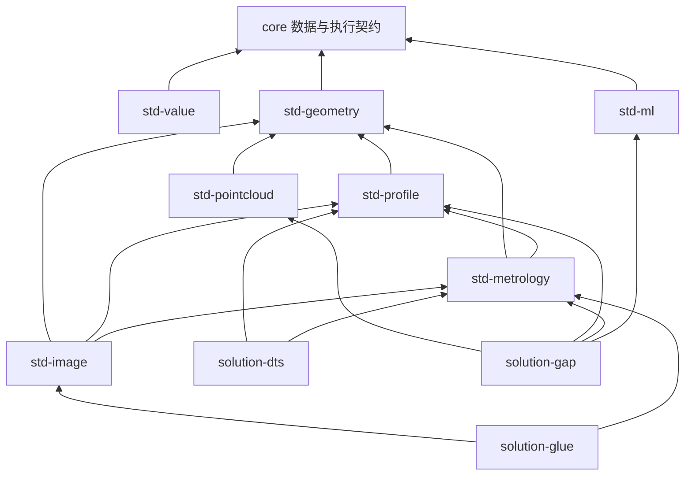

# 算子包边界重整

状态：规划，尚未迁移实现。源码基线为 `9940c8c45ef301910add57e48186fce0b543e341`（LyFlow 1.3.12）。

本轮以实际注册和实现为依据，重划通用能力、测量语义、场景组合及内部后端的责任。当前构建方式仍以[算子包机制](op-packs.md)为准；本页中的新包、模块和依赖声明是目标，不是已经存在的构建选项。

逐项结论见[算子迁移清单](operator-package-audit.md)，机器可读数据见[完整清单 JSON](operator-package-audit.json)，实施顺序见[迁移计划](operator-package-migration-plan.md)。原[外部能力补齐计划](operator-completion-plan.md)解决能力缺失，本计划解决已有能力归属，两者不互相代替。

## 清点范围与证据

| 当前归属 | 原生算子数 |
|---|---:|
| core | 4 |
| std-value | 16 |
| std-geometry | 35 |
| std-pointcloud | 52 |
| std-image | 76 |
| std-ml | 1 |
| dts | 8 |
| gap | 39 |
| glue | 20 |
| 合计 | 251 |

当前正式组合导出 243 项，DTS 不在 `packaging/release.json` 的正式组合内。243 项描述来自本机已验证的 1.3.12 原生 manifest；对应构建源码 `6feaca4` 与本基线的原生实现一致，差异仅为两个 Python 工具脚本。DTS 的 8 项端口描述参考旧 1.1.0 manifest，并逐项核对当前注册、参数和计算源码；它不构成本轮重新构建完整 DTS 运行库的证据。

另逐项记录仓库随附的 7 个 Python 示例节点。用户运行时导入的 `py.*`、用户组合库 `lib.*`、外部目录包及测试专用节点没有固定封闭集合，不计入原生 251 项。它们的扩展接口、缺依赖行为及随运行库交付的示例仍必须参加迁移验收。附属资产另清点 6 种 StandardGap 导入器、7 个随包片段、6 种 Bundle；不把这些误计为算子。

## 目标归属

| 目标 | 应当负责 | 不应承担 | 依赖规则 |
|---|---|---|---|
| core | 调度、图校验、数据所有权、缓存、取消、诊断、注册与扩展接口；透传和惰性分支原语 | 合成点云、拟合、检测、测量业务规则 | 保持零视觉后端；数据结构不能引入 PCL、OpenCV 或 ORT 类型 |
| std-value | 标量、受限表达式、同型集合、字段及逻辑运算 | 工件几何语义、大数组存储、生产判定 | core 与标准库 |
| std-geometry | 几何元素、坐标变换、位姿及纯几何关系、小型定位点刚体计算 | 点云拟合、采样顺序处理、图像检测、行业基准选择 | 默认无重后端；workspace-io 可选依赖 yaml-cpp，几何计算不因此被迫链接 YAML |
| std-profile（新） | 轮廓视图、保序清洗、分段、极值、线段/圆弧特征与轮廓配对 | 胶条或金件的角色判断、双相机可信度策略、三维无序点云算法 | 默认portable不依赖PCL/CV/ORT；原PCL拟合方法经显式可选backend适配，不能牵连DTS轻量配置 |
| std-pointcloud | 云 I/O、空间滤波、点索引/通道处理、分割、云上拟合和配准 | 以工件名定义的业务 ROI、轮廓列序规则、最终间隙定义 | 拆 portable、PCL、matching 能力模块；按模块显式启用依赖 |
| std-image | 图像 I/O/预处理、标定、成像投影、卡尺、颜色/路径/栅格分析、图像专用模型适配 | Tensor 推理运行会话、胶宽合格阈值、已脱离观测的通用几何计算 | 拆 portable-depth、OpenCV、marker、barcode、calibration-io 等模块；不要把全部附带库算到每个算子头上 |
| std-ml | 通用 Tensor 推理、纯张量模型输出适配和模型执行策略 | 依赖图像采样的预处理、工件类别/ROI 含义、现场合格判据 | adapters 与 runtime 分开；runtime 经内部 ml-runtime 接 ORT，adapters-only 不链接 ORT |
| std-metrology（新） | 基准/方向明确的尺寸、间隙、面差、投影测量及测量质量 | 重复基础点线圆距离算法、选择胶条根部、决定产品 OK/NG、隐式单位修正 | 只依赖公开几何/轮廓契约及轻量内部测量核；图像采样和云拟合由上游提供 |
| solution-dts | 胶条凸起、基准钣金选择、根部规则、结果封装和场景工作流 | 通用清洗、拟合和垂距算法的第二份实现 | std-profile、std-geometry、std-metrology；默认无重后端 |
| solution-gap | 双头采集适配、1280 槽模型约定、模板/模型 ROI、相机选择、领域结果和导入器 | 通用空间处理、推理服务、通用间隙/面差内核的副本 | 按模板、模型及 I/O 模块声明 profile/pointcloud/ml/metrology/YAML 需求 |
| solution-glue | 胶路语义、示教/站位约定、断胶规则、领域质量汇总和业务判定 | 通用颜色响应、卡尺、折线重采样、图像边缘算法的副本 | 按场景需要声明 image/metrology/geometry；最终生产决定由宿主按契约接收 |

目标场景源码建议位于 `solutions/dts`、`solutions/gap`、`solutions/glue`，包标识分别为 `solution-dts`、`solution-gap`、`solution-glue`。旧 `dts`、`gap`、`glue` 不是直接一对一改名：逐项先抽公共能力，再搬剩余场景节点。场景层可以包含必要原生算法，不要求全部改成 JSON，也不要求把每个复杂测点展开成用户难以维护的几十个节点。

## 四种边界分别管理

1. **公开算子包**决定能力归属、注册描述和工作流依赖。
2. **内部算法库**提供 C++ 复用接口。算子不应通过另一个包的注册函数或私有 `ops/*.h` 复用算法。
3. **后端/能力模块**决定 PCL、OpenCV、ORT、KISS-Matcher、small_gicp、ZXing/ZBar、字典及 YAML 等依赖是否参与构建。
4. **场景工作流/组合节点**决定业务编排、模型约定与结果协议。它们不反向进入通用包。

公开包名并不等于全部后端一起启用。模块隔离必须由独立 CMake target、传递链接检查、manifest 能力清单和无依赖构建证明；仅在 README 写“可选”不算隔离。

箭头表示允许的依赖方向，不表示每个模块都必须链接箭头下方全部内容。image 的深度/云投影消费 core PointCloud，不依赖 std-pointcloud 的注册；深度检查和切片包装可使用profile/metrology的轻量公共核，相机/标定共享记录不能迫使 geometry 反向依赖 image。image 与 ml 的交换通过 Tensor/Record 公共协议完成，禁止形成包注册环。

## 数据契约先于搬迁

| 数据 | 当前事实 | 目标及迁移门槛 |
|---|---|---|
| 轮廓 | DTS 的 PointCloud 为 XZ、毫米、y=0；gap 进入测量链后为米制 XY；部分模型节点必须保留原始 1280 槽与 NaN | 明确 Profile 契约：frame、unit、平面/轴映射、sampleOrder、validity、sourceIndices；提供显式 PointCloud↔Profile 适配，不复制一份大数组进 Record |
| 点序 | DTS 分片依赖采样邻接；`profile.analyze` 当前全点 TLS 不依赖点序；普通云滤波可能改序 | 每个节点声明 preserves/reorders/compacts 的行为；不能给旧无序算法强加有序前提，也不能默默按 x 排序 |
| 单位 | DTS 坐标毫米；gap 参数常用毫米、云坐标米；基础 2D 几何为 m/px；Image 为像素栅格 | 新公共物理几何及测量核以 m/rad 为规范；旧 mm 输入在场景边界显式转换；像素值只有经过明确标定才成为物理尺寸 |
| DTS旧几何单位标签 | `Unit2D`只有Meter/Pixel，DTS的seal_dome/pick_metal/seal_root/flush写入毫米数值却保留默认Meter标签 | 依据DTS来源/旧版本识别并显式乘0.001；不能只信旧unit字段。保留方向与独立Measurement单位，并验证往返及1000倍误接 |
| 坐标变换 | `gap.to_measurement_frame` 的换轴含反射，不是右手刚体旋转 | 区分轴映射与 SE(3)；Profile 适配记录 handedness/轴对应，不伪装为普通 rigid Transform |
| 几何与位姿 | 标准 Point2D/Line2D/Circle2D 带单位，工件 Record 带身份/frame/unit | 共享校验进入公开内部接口；小型 Record 可承载身份和质量，大点集仍用原生缓冲；保持有限线段、方向、四元数和退化语义 |
| Image/深度 | RGB/RGBA、位深和 stride 有既定契约；深度需要比例、无效值和相机约定 | 图像采样留在 image；profile/metrology 只接提取后的特征和明确单位；掩膜/映射/深度无效值不能用零冒充有效观测 |
| Tensor/模型 | ORT 执行与图像前后处理实际分离；YOLOv8/11/26 等版本的布局及通道约定不同 | runtime 与 adapter 模块分开；逐模型固定输入输出布局、类别数、颜色、letterbox/坐标回映，模型不兼容必须报诊断 |
| Measurement/质量 | gap/DTS/glue 的符号、基准与领域判据不同；基础 geometry.distance 也有多种合法定义 | metrology 明确 datum、方向、定义、单位、support 和 valid/reason；算法有效不等于产品合格，不把未测得当作数值零 |
| Bundle/Record | gap 的 ScanPair/RoiSet 与 glue 的图像响应/路径结构混有公共和场景语义 | 逐种记录发布所有者、schema 与共享字段，先迁消费者再删除旧声明；标识迁移不能只修改命名空间字符串 |

Profile 的目标是有类型、可校验、可由原生缓冲共享的契约。M1 必须完成新原生端口/原生 Frame 视图方案的 ABI、Rust、Python、CLI、Transport 及编辑器评审和夹具后才定版；当前实现并不存在一个可以直接使用的 Profile 端口。不能先往普通 Record 放完整数组，之后再补大数据和生命周期语义。

公共契约至少覆盖只读输入、复制/共享所有权、附加通道长度、空集合、无效槽、取消、缓存指纹和诊断原子性。不同方法可并存：TLS、RANSAC、固定半径、软先验不是重复算子的同义词，分包不构成替换算法的理由。

## 必须处理的实际耦合

- `lyflow_std_algo` 当前由 std-pointcloud 导出并传递 PCL；DTS 轻量拟合不能直接改接它。应先提取可独立编译的数值核，PCL 拟合继续作为独立实现后端。
- `packs/std-pointcloud/ops/p5_primitive_crop.cpp` 包含 std-geometry 私有实现头；图像的模型/位姿辅助代码也需逐处核对。公开数据校验和算法服务必须先形成明确内部接口，再移走原文件。
- `workspace.load` 的实际读取依赖是 YAML 与轻量位姿契约，不应因为目前位于 image 就要求 OpenCV；归入 geometry 的可选 workspace-io 模块。
- YOLO/OCR 的纯 Tensor 解码归 ml/adapters，纯Tensor/Record数值坐标回映可随解码器迁移；图像采样、重采样和叠画继续归 image。移动前抽取共享检测/OCR记录，避免反向 include。
- 同名 `image.PlaneCalib` 当前有两种校验语义：图像私有旧解析器默认毫米并接受非空单位字符串，core公开解析器要求显式m/mm并归一化齐次H。统一验证必须先定义版本/旧输入迁移，不能把替换include误记成无行为变化的搬包。
- `gen.synthetic` 最终归 std-pointcloud 的 portable-generation。纯 core 从当前 4 个节点收敛为 3 个透传/调度节点，相关测试与发布断言必须先改用明确的 fixture 或启用生成模块。
- CMake 当前使用包优先级列表安排 include 顺序。目标改为显式声明包/模块及后端依赖，配置期检查环、缺依赖、ID 冲突和不完整能力组合，不能依赖目录字母序或全局变量先后赋值。

## 包迁移与 ID、版本、图迁移

纯文件/注册归属移动默认不改算子 ID、端口、参数和计算方法，pack 元数据与构建身份单独更新。命名更清晰不要求永久维护全部旧显示名称；但已保存的工作流不能因此静默丢节点和连线。

拆分节点或改变单位/端口时，按照 [ADR-0008](adr/0008-migration-as-diagnostic.md) 与 [ADR-0025](adr/0025-topology-migration.md) 定义迁移诊断和图编辑。可证明等价的参数/拓扑重写可以复用现有机制；缺 frame、缺标定、槽映射不明或领域定义不同的情况必须停止并说明所缺信息，不能靠猜测继续计算。旧→新 ID 映射、是否存在临时适配节点和退役条件在对应迁移 PR 中冻结。

记录/Bundle schema、C ABI、Frame/端口类型以及 SDK 布局的变化按[打包和 ABI 规则](deployment/packaging.md)推进。不能只提升 pack.version 来掩盖宿主 ABI 变化，也不预先宣布本次规划必然是某个具体产品大版本。

## 构建与交付目标

| 配置 | 内容 | 必须证明 |
|---|---|---|
| core-minimal | core 三个透传/惰性调度节点 | 无 PCL/CV/ORT；Python 未配置时原生流程正常 |
| profile-metrology | value/geometry/profile/metrology 及 DTS 场景 | 不出现 PCL/CV/ORT 导入；保序、单位和已验证 DTS 测量行为成立 |
| image-inspection | image 指定模块及 glue 场景 | 仅依赖实际启用的图像/识码后端，ORT 不因颜色/卡尺被附带 |
| gap-template / gap-model | gap 场景及所需 profile/metrology/云配准或模型模块 | 模板路径不被迫加载不使用的模型；模型路径只按明确能力启用后端 |
| full-dev | 全标准能力与三个场景 | manifest、片段、图迁移、全量回归无缺项，测试型节点不混入正式注册 |
| installed-sdk | 固定能力清单的运行库与 SDK | CLI、独立 C++17、Rust、Python 和可选 Transport 对同一数据得到一致结果 |

这些是目标配置名，不是现有脚本参数。正式发布当前包含 gap/glue、不包含 DTS；添加 DTS 或引入新配置必须显式更新发布必需算子、依赖缓存身份、许可证、资产及 SDK 独立消费门禁。源码包拆分仍使用当前静态编入 core 的机制，本轮不顺带引入运行时 C++ 插件 DLL ABI。
